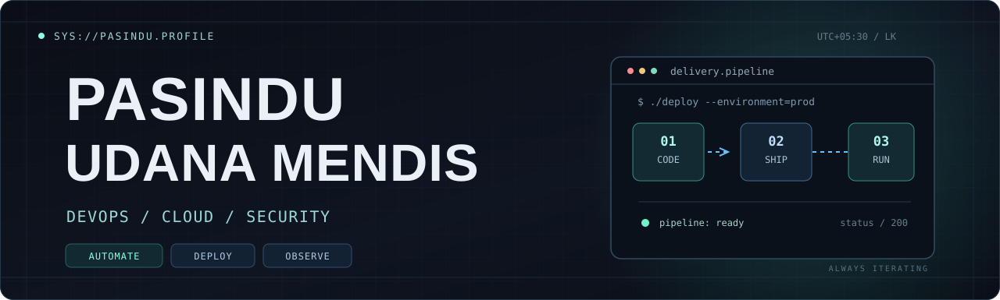

<div align="center">

<!-- Header Banner / Hero -->


<!-- Animated Waves Header Divider -->


<br/>

<!-- Typing SVG Animation -->
<a href="https://git.io/typing-svg">
  
</a>

<br/>

<!-- Quick Badges -->
<p align="center">
  <a href="https://github.com/Pasindu115530"></a>
  
  
</p>

</div>

---

### 📌 About Me

<table>
  <tr>
    <td width="55%" valign="top">

```javascript
const pasindu = {
    name: "Pasindu Udana Mendis",
    role: "Computer Science Undergraduate",
    institution: "University of Sri Jayewardenepura",
    location: "Sri Lanka 🇱🇰",
    passions: [
        "DevOps & Infrastructure Automation",
        "Cloud Architecture (AWS)",
        "System Reliability & Security"
    ],
    currentFocus: [
        "Docker & Containerization",
        "CI/CD Pipelines (GitHub Actions)",
        "Linux Server Administration"
    ],
    nextGoals: ["Kubernetes", "Terraform", "Prometheus & Grafana"],
    mindset: "Don't stop when it works locally. Make it reproducible and scalable."
};
```

> *"Simplicity is prerequisite for reliability."* — Edsger W. Dijkstra

   </td>
   <td width="45%" align="center" valign="middle">
     
   </td>
  </tr>
</table>

---

### 📬 Connect With Me

<p align="left">
  <a href="https://github.com/Pasindu115530" target="_blank">
    
  </a>
  <a href="https://linkedin.com/in/" target="_blank">
    
  </a>
  <a href="mailto:contact@example.com">
    
  </a>
</p>

---

### 🛠️ Tech Stack & Operations Toolbox

<div align="center">

#### Languages & Core
<p>
  
</p>

#### Infrastructure, Cloud & DevOps
<p>
  
</p>

#### Frameworks, Databases & Developer Tools
<p>
  
</p>

</div>

---

### 🚀 Active Labs & Projects

| Project / Lab | What I'm Building & Practicing | Tech Stack |
| :--- | :--- | :--- |
| **🛡️ Sentinel — Access Governance** | Centralized security logs & access review workflows | Ubuntu VPS, WireGuard, Syslog, PostgreSQL |
| **📡 CertRadar AI** | Discovery and alert platform for certification opportunities | Docker, Deployment Pipelines, Monitoring |
| **⚙️ Self-hosted Deployment Lab** | Deploying backend/frontend services with managed reverse proxy | Coolify, Nginx, Docker, Linux |

<p align="center">
  <a href="https://github.com/Pasindu115530?tab=repositories">
    
  </a>
</p>

---

### 📊 GitHub Telemetry & Stats

<div align="center">

<!-- GitHub Trophy Showcase -->
<a href="https://github.com/ryo-ma/github-profile-trophy">
  
</a>

<br/><br/>

<!-- Stats Cards -->

&nbsp;


<br/><br/>

<!-- Contribution Activity Graph -->


<br/><br/>

<!-- Streak Stats -->


</div>

<!-- Animated Waves Footer Divider -->


<p align="center">
  <sub><code>pasindu@devops:~$</code> keep learning · keep shipping · keep improving ▌</sub>
</p>
