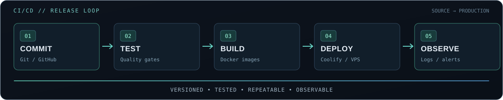

<div align="center">

<br />
<a href="https://git.io/typing-svg"></a>
<br />
<a href="https://github.com/Pasindu115530"></a>


</div>
`01 / whoami`
```bash
$ whoami
> Pasindu Udana Mendis
> Computer Science undergraduate | University of Sri Jayewardenepura
> DevOps & Cloud enthusiast | Builder | Problem solver

$ cat mission.txt
> Build useful software.
> Automate the repetitive parts.
> Make deployments safer, observable, and repeatable.
```
I'm exploring the space where software engineering meets infrastructure — from writing applications to shipping them on Linux servers, securing service communication, and understanding what happens after deployment.
🔧 Hands-on: Linux, Git/GitHub, Docker, Nginx, PostgreSQL, Coolify, Python, and deployment workflows.
☁️ Exploring: cloud infrastructure, AWS, CI/CD, security, monitoring, and infrastructure automation.
🎯 Next milestones: GitHub Actions, Terraform, Kubernetes, Prometheus, and Grafana.
`02 / the delivery loop`
<div align="center">
  
</div>
> **Engineering mindset:** Don't stop when it works locally. Make it reproducible, deployable, and maintainable.
`03 / operations toolbox`
<div align="center">
Languages & development

Infrastructure & delivery

Data, tooling & systems

</div>
<details>
<summary><b>🔍 What I'm learning next</b></summary>
<br />
Area	Learning path
Infrastructure as Code	Terraform, reusable modules, remote state
Containers at scale	Kubernetes, Helm, cluster operations
CI/CD	GitHub Actions, test gates, release automation
Observability	Prometheus, Grafana, alerts and dashboards
Cloud foundations	AWS IAM, networking, compute, storage
Security	Least privilege, secrets management, secure log transport
</details>
`04 / active labs`
Not just tutorials — I'm using projects to understand how real systems are operated.
Project / lab	What I'm building & practicing	DevOps angle
🛡️ Sentinel — Access Governance	Centralized Windows/Linux security logs and access-review workflows	Ubuntu VPS, WireGuard, syslog, PostgreSQL, security
📡 CertRadar AI	Discovery and alert platform for free certification opportunities	Dockerized services, deployment pipelines, monitoring (planned)
⚙️ Self-hosted Deployment Lab	Deploying backend/frontend services to a VPS with managed routing	Coolify, Git, reverse proxy, environment configuration
<sub>These are ongoing learning/build projects, not claims of production-scale deployment.</sub>
<div align="center">
  <a href="https://github.com/Pasindu115530?tab=repositories"></a>
</div>
`05 / github telemetry`
<div align="center">


<br />

</div>
`06 / connect`
<div align="center">
Interested in DevOps, cloud, infrastructure, open source, or building something useful?
<a href="https://github.com/Pasindu115530"></a>
<!-- Replace with real details, then uncomment:
<a href="https://www.linkedin.com/in/YOUR-HANDLE/"></a>
<a href="mailto:YOUR_EMAIL@example.com"></a>


<sub><code>pasindu@devops:~$</code> keep learning · keep shipping · keep improving ▌</sub>
</div>
